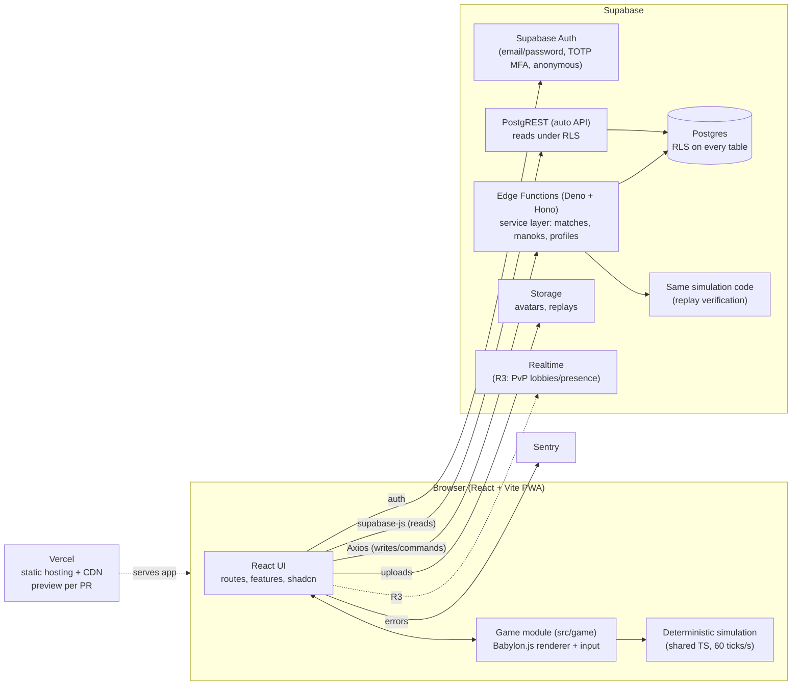
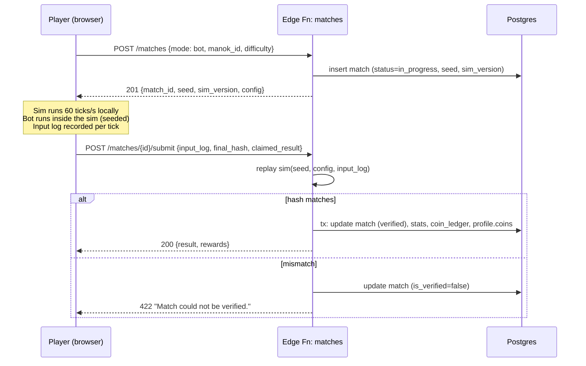

# System Architecture & Technology Stack

| Field | Value |
|---|---|
| SDLC phase | Design |
| Status | Draft v0.1 |
| Baseline | ICT Information System Blueprint 2026 (Frontend, Conventions, Security, DevOps, SDLC). **Laravel is replaced by Supabase.** |
| Related | [database-design.md](./database-design.md), [api-design.md](./api-design.md), [game-engine-design.md](./game-engine-design.md), [ui-ux-design.md](./ui-ux-design.md) |

---

## 1. Architecture overview



### Key architectural decisions (ADR summary)

| ID | Decision | Reason |
|---|---|---|
| ADR-01 | **Supabase replaces Laravel**: Postgres + RLS for data, Auth for identity, Edge Functions as the service layer, Storage for files, Realtime for push. | Requested; less backend to run; RLS gives row-level authorization close to the data. |
| ADR-02 | **Reads go directly through supabase-js under RLS; every write that touches game state (coins, results, ownership, ratings) goes through an Edge Function.** The client has no INSERT/UPDATE rights on those tables. | Keeps "thin controller + service" discipline from the Blueprint and prevents cheating. |
| ADR-03 | **Deterministic, fixed-tick simulation in pure TypeScript**, shared by the browser and the Edge Function. Rendering is a separate layer that only reads sim state. | Server-side replay verification (FR-MATCH-02) now; PvP netcode (rollback) later. |
| ADR-04 | **Babylon.js** (ES module packages `@babylonjs/core`, `@babylonjs/loaders`) for 3D; React only for menus/HUD. | Game-engine features built in (animation groups, glTF, shadows, particles); stays in TypeScript. |
| ADR-05 | **Hono** router inside each Edge Function, organized as routes → controller → service → repository. | Mirrors the Blueprint's Laravel layering. |
| ADR-06 | **Zod schemas shared** by the frontend and Edge Functions from `supabase/functions/_shared/schemas`. | Blueprint rule: client validation must mirror server validation. One source of truth. |
| ADR-07 | **Axios** stays the single HTTP client for Edge Function calls (with the Blueprint's interceptors); supabase-js is used for Auth, PostgREST reads, Storage and Realtime. | Keeps Blueprint's global error handling (401/403/422/429/500). |
| ADR-08 | **Frontend hosted on Vercel** (Hobby plan, personal project); backend stays on Supabase Cloud. | Static Vite build fits Vercel's CDN; Git-based deploys and a preview URL per PR replace the Blueprint's IIS test/staging sites. |

---

## 2. Blueprint → Supabase mapping

### 2.1 Backend (Laravel stack replaced)

| Blueprint category | Blueprint (Laravel) | **This project (Supabase)** |
|---|---|---|
| Backend framework | Laravel 13 | Supabase (Postgres 15+, PostgREST, GoTrue Auth, Edge Functions on Deno) |
| API architecture | REST API | REST: PostgREST (reads) + Edge Functions with Hono (commands) |
| API authentication | Sanctum bearer tokens | Supabase Auth JWT (access token + refresh token), sent as `Authorization: Bearer` |
| Storage | Laravel Storage, S3 | Supabase Storage (S3-compatible), private buckets + signed URLs |
| Email service (MFA) | Office 365 / Gmail SMTP | Supabase Auth with custom SMTP (Office 365 or Gmail) for confirm/reset emails; MFA via **TOTP** |
| SMS service | Semaphore / Globe | Not needed in R1 (phone MFA could use a Supabase SMS hook later) |
| PDF | DomPDF, tcPDF | Not needed |
| Push notification | Reverb | Supabase Realtime (R3) |
| Error monitoring | Sentry (not used) | Sentry (frontend) + Edge Function structured logs |
| Testing | Pest | **pgTAP** (`supabase test db`) for schema/RLS; **Deno test** for Edge Functions; Vitest for shared sim |
| API docs | Scramble | `docs/02-design/api-design.md` + OpenAPI file `supabase/openapi.yaml` (hand-written, kept in sync) |
| Local server | Herd / Laragon | **Supabase CLI** (`supabase start`, runs the stack in Docker) |
| DB management | TablePlus / DBeaver / Navicat / Workbench | Supabase Studio (local + cloud); TablePlus/DBeaver over the Postgres connection |
| DB server | MySQL via DBngin/Laragon | Postgres (Supabase) |
| Migrations | `database/migrations` | `supabase/migrations/*.sql` (Supabase CLI) |
| Seeders | `database/seeders` | `supabase/seed.sql` (reference data) + `supabase/seeds/dev/*.sql` (test data) |
| Factories | `database/factories` | Test helpers in `supabase/tests/helpers.sql` and Deno test fixtures |
| Controllers / Requests / Services / Resources / Policies | Laravel classes | Hono route handlers / Zod request schemas / service modules / response mappers / **RLS policies + SQL helper functions** |
| Code style | Pint (PSR-12) | Prettier + ESLint for TS (Edge Functions included); `supabase db lint` + **sqlfluff** for SQL |
| Git hooks | CaptainHook | Husky (one set of hooks for the whole repo) |

### 2.2 Frontend (Blueprint kept, with game additions)

| Category | Blueprint | This project | Notes |
|---|---|---|---|
| Framework | React (TypeScript) | ✅ React 19 + TypeScript (strict) | |
| Bundler | Vite | ✅ Vite | |
| Package manager | npm | ✅ npm | |
| Router | react-router-dom | ✅ react-router-dom | |
| Forms | React Hook Form + Zod/Yup | ✅ React Hook Form + **Zod** (no Yup) | |
| State | Zustand, TanStack Query | ✅ | See [ui-ux-design.md](./ui-ux-design.md) §5 |
| HTTP client | Axios | ✅ Axios for Edge Functions; supabase-js for Auth/reads/Storage | ADR-07 |
| UI framework | Shadcn + Tailwind (MUI unused) | ✅ Shadcn + Tailwind CSS | No MUI |
| Data tables | TanStack Table | ✅ Match history, admin lists | |
| Error monitoring | Sentry | ✅ `@sentry/react` | |
| Push/WebSocket | Laravel Echo | ➜ supabase-js Realtime (R3) | |
| Unit tests | Vitest, happy-dom | ✅ + React Testing Library | |
| PDF / rich text / DOM-to-image | react-pdf, Lexical/Tiptap, html-to-image | ✗ Not used | Not needed by a game |
| Icons | lucide-react | ✅ | |
| Charts | ApexCharts | ✅ Profile stats (R2) | |
| Toasts | Sonner | ✅ | |
| Theme | next-themes | ✅ Menus only; the 3D scene has its own lighting | |
| Utility | Lodash | ✅ `lodash-es` (tree-shaken); **never inside the simulation** | Sim must be dependency-free |
| PWA | vite-plugin-pwa, Workbox | ✅ Caches app shell + models for offline bot play | |
| Git hooks | Husky | ✅ | |
| **Added: 3D engine** | — | `@babylonjs/core`, `@babylonjs/loaders` | ADR-04 |
| **Added: Supabase client** | — | `@supabase/supabase-js` | |
| **Added: E2E tests** | — | Playwright (smoke flows) | Optional in R1 |
| **Added: Local queue** | — | `idb-keyval` (IndexedDB) | Pending match submissions (NFR-REL-01) |

### 2.3 Not used from the Blueprint
- **Mobile framework** (React Native/Expo): out of scope (NG3).
- **Windows IIS on-premise server:** replaced by **Vercel** for the frontend (ADR-08) and Supabase Cloud for the backend. This is a personal project, so the Blueprint is followed voluntarily and this deviation needs no approval.
- **Redis:** not needed. Supabase Postgres + Edge Functions cover caching needs at this scale.
- **Laravel Sail:** replaced by the Supabase CLI local stack.

---

## 3. Repository structure (monorepo)

```
sabong/
├── CLAUDE.md                     # Instructions for AI agents (points to /docs)
├── README.md
├── docs/                         # These specs (single source of truth)
├── frontend/                     # React + Vite app (Blueprint frontend layout)
│   ├── src/                      # see §4
│   ├── public/models/            # .glb assets (manok, arena props)
│   ├── vercel.json               # SPA rewrites, cache + security headers
│   ├── Dockerfile                # optional, local dev only
│   └── package.json
├── supabase/                     # Supabase project (replaces backend/)
│   ├── config.toml
│   ├── migrations/               # YYYYMMDDHHMMSS_description.sql
│   ├── seed.sql                  # reference data (breeds, skills, taris)
│   ├── seeds/dev/                # dev-only test data
│   ├── tests/                    # pgTAP tests (*.test.sql)
│   ├── openapi.yaml
│   └── functions/
│       ├── _shared/              # shared by all functions AND by the frontend
│       │   ├── sim/              # deterministic game simulation (pure TS)
│       │   ├── schemas/          # Zod request/response schemas
│       │   ├── http/             # envelope, errors, cors, auth middleware
│       │   └── db/               # supabase admin client factory
│       ├── matches/              # /functions/v1/matches
│       ├── manoks/               # /functions/v1/manoks
│       ├── profiles/             # /functions/v1/profiles
│       └── admin/                # /functions/v1/admin (R2)
├── tools/
│   └── blender/build_manok.py    # rebuilds manok.glb headlessly
├── .github/workflows/            # ci.yml, deploy.yml
├── .husky/
└── package.json                  # root scripts (lint-staged, husky, workspace helpers)
```

### 3.1 Sharing code between Deno (Edge Functions) and Vite (frontend)

`supabase/functions/_shared/sim` and `_shared/schemas` are imported by both runtimes. To make one file valid in both:

1. **Relative imports include the `.ts` extension** (Deno requires it). The frontend `tsconfig` enables `"allowImportingTsExtensions": true` (valid with `noEmit`, which Vite uses).
2. **Bare specifiers only for npm packages** (e.g. `import { z } from 'zod'`). Deno resolves them through `supabase/functions/deno.json` import map (`"zod": "npm:zod@^3"`); Vite resolves them from `frontend/node_modules`. Both pin the **same major version**.
3. **No runtime-specific APIs** in shared code: no `Deno.*`, no DOM, no Node built-ins, no `Math.random()`, no `Date.now()`.
4. The frontend imports them through path aliases: `@sim/*` → `../supabase/functions/_shared/sim/*`, `@schemas/*` → `../supabase/functions/_shared/schemas/*` (set in `tsconfig.json` and `vite.config.ts`, with `server.fs.allow` including `../supabase/functions/_shared`).
5. CI type-checks shared code twice: with `tsc` (frontend config) and with `deno check`.

---

## 4. Frontend directory layout

Follows the Blueprint layout exactly. Game-specific additions are marked **(added)**.

| Directory | Purpose |
|---|---|
| `src/app/routes/<domain>/` | Route-level pages & router config (`auth`, `lobby`, `roster`, `fight`, `matches`, `leaderboard`, `profile`, `settings`, `admin`) |
| `src/assets/images/` | Static images (logo, breed portraits, UI art) |
| `src/components/auth/` | `ProtectedRoute`, `RoleGate` |
| `src/components/buttons/` | Reusable buttons (e.g. `GameButton`) |
| `src/components/common/` | Modals, loaders, empty states |
| `src/components/data-display/` | Stat cards, record badges |
| `src/components/error/` | Error boundary, error fallback, **WebGL-not-supported page** |
| `src/components/feedback/` | Confirm dialogs, status badges |
| `src/components/file/` | Avatar upload |
| `src/components/form/` | Form shell, field components, form utils |
| `src/components/inputs/` | Search bar, filters |
| `src/components/layout/AppShell/` | Menu shell, top bar, nav (hidden during fights) |
| `src/components/overlay/` | Side panes, pause overlay |
| `src/components/pwa/` | Install prompt, update prompt |
| `src/components/table/` | DataTable, pagination |
| `src/components/tabs/` | Tab components |
| `src/components/ui/` | Shadcn primitives |
| `src/config/` | Env parsing (Zod), constants, permissions, **key bindings defaults** |
| `src/context/` | Auth, PWA providers |
| `src/features/<domain>/…` | `access/`, `api/`, `components/{atoms,molecules,organisms,templates}/`, `constants/`, `data/`, `hooks/`, `lib/`, `provider/`, `stores/`, `types/`, `utils/`, `index.ts` |
| **`src/game/` (added)** | The game client: `engine/` (Babylon scene, loop), `render/` (manok view, arena, VFX, camera), `input/` (keyboard, gamepad, touch → `InputFrame`), `audio/`, `assets/` (loader + manifest), `bridge/` (sim ↔ React store throttle). Imports the simulation from `@sim`. |
| `src/hooks/` | Cross-cutting hooks |
| `src/lib/axios.ts` | Single Axios instance for Edge Functions |
| **`src/lib/supabase.ts` (added)** | Single supabase-js client |
| `src/lib/permissions/` | Role helpers |
| `src/lib/utils.ts` | `cn()` and shared helpers |
| `src/providers/` | QueryClient, PWA, Sentry, Theme |
| `src/stores/` | `authStore`, `uiStore`, `settingsStore` |
| `src/testing/` | Vitest setup |
| `src/types/` | `ApiResponse<T>` envelope types, **`database.types.ts` (generated by `supabase gen types`)** |
| `src/utils/` | Cross-cutting utilities |

**Feature domains:** `auth`, `profile`, `manok`, `match`, `leaderboard`, `settings`, `admin`.

**Why `src/game/` is not a feature:** the game client is a real-time engine, not a set of React components with API calls. It has no atomic-design tiers. React talks to it only through `src/game/bridge` and the `match` feature's organisms (`FightView`, `Hud`).

---

## 5. Runtime flows

### 5.1 Bot fight (R1)



### 5.2 Authentication
1. `supabase.auth.signUp` / `signInWithPassword` (CAPTCHA token attached).
2. A Postgres trigger on `auth.users` insert creates the `profiles` row. The starter manok is granted by `POST /functions/v1/manoks/starter` on first lobby load, which is idempotent (see api-design).
3. supabase-js persists and refreshes the session. `authStore` mirrors `session`/`user`/`profile` for components. It does **not** store the token a second time (deviation from Blueprint's "token in Zustand persist", because supabase-js already persists it securely and refreshes it).
4. Axios request interceptor reads the current access token from `supabase.auth.getSession()` and adds `Authorization: Bearer`.
5. Logout: `supabase.auth.signOut()` revokes the refresh token server-side.

---

## 6. Environments

| Environment | Blueprint name | Supabase | Frontend | Purpose |
|---|---|---|---|---|
| Local | Local Environment | `supabase start` (Docker) | `npm run dev` (5173) | Development |
| Test | Test Site | Supabase project `sabong-test` | Vercel Preview: a URL per PR + `dev.<domain>` (`development` branch) | Alpha/Beta |
| Staging | Staging Site | Supabase project `sabong-staging` | Vercel Preview with branch domain `staging.<domain>` | UAT, final verification |
| Production | Production Site | Supabase project `sabong-prod` | Vercel Production (`main`) | Live |

Details in [deployment.md](../05-deployment/deployment.md).
