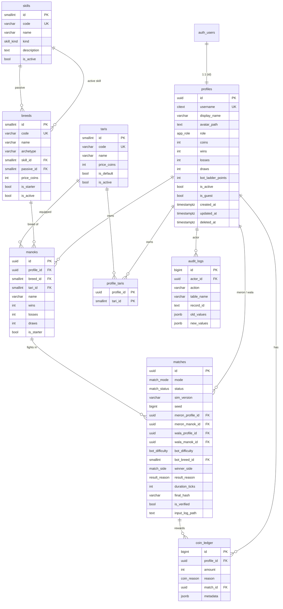

# Database Design (Supabase Postgres)

| Field | Value |
|---|---|
| SDLC phase | Design |
| Status | Draft v0.1 |
| Conventions | Blueprint "Naming Conventions → Database" (snake_case plural tables, `{table_singular}_id` FKs, `created_at`/`updated_at` on all tables, `deleted_at` on master tables, `is_` boolean prefix) |
| Related | [api-design.md](./api-design.md), [architecture.md](./architecture.md) |

---

## 1. Principles

1. **RLS is enabled on every table in `public`**. A table without policies is unreachable from the client, which is the safe default.
2. **The client never writes game state.** Coins, results, records, ratings, ownership and roles change only inside Edge Functions using the service role, through **SQL functions that run in one transaction** (the Supabase equivalent of Laravel's `DB::transaction()`).
3. **Gameplay numbers are not in the database.** Damage, frame data and breed modifiers live in versioned simulation code (`_shared/sim/data`) so replays stay deterministic. The database stores the **catalog** (what exists, names, prices, availability) keyed by a stable `code` that matches the sim data.
4. **Constraints mirror validation.** Every `varchar(n)`, `check` and enum here has a matching Zod rule in `_shared/schemas` (Blueprint: "validation rules must mirror the database constraints exactly").
5. **Soft deletes** (`deleted_at`) on master tables: `profiles`, `manoks`, `breeds`, `skills`, `taris`.

---

## 2. Entity-relationship diagram

---

## 3. Enum types

| Type | Values |
|---|---|
| `app_role` | `player`, `admin` |
| `skill_kind` | `active`, `passive` |
| `match_mode` | `bot`, `pvp_casual`, `pvp_ranked` |
| `match_status` | `in_progress`, `completed`, `abandoned`, `rejected` |
| `match_side` | `meron`, `wala`, `draw` |
| `result_reason` | `ko`, `talikod`, `timeout`, `forfeit` |
| `bot_difficulty` | `easy`, `normal`, `hard` |
| `coin_reason` | `match_reward`, `daily_bonus`, `purchase`, `admin_adjustment`, `refund` |

---

## 4. Tables

All tables also have `created_at timestamptz not null default now()` and `updated_at timestamptz not null default now()` (maintained by the `set_updated_at()` trigger). They are omitted below to save space.

### 4.1 `profiles` (master, soft delete)

| Column | Type | Constraints |
|---|---|---|
| `id` | `uuid` | PK, FK → `auth.users(id)` on delete cascade |
| `username` | `citext` | not null, unique, `check (username ~ '^[a-z0-9_]{3,20}$')` |
| `display_name` | `varchar(40)` | not null, `check (char_length(trim(display_name)) between 1 and 40)` |
| `avatar_path` | `text` | null; path inside `avatars` bucket |
| `role` | `app_role` | not null default `player` |
| `coins` | `integer` | not null default 0, `check (coins >= 0)` |
| `wins` / `losses` / `draws` | `integer` | not null default 0, `check (>= 0)` |
| `bot_ladder_points` | `integer` | not null default 0 |
| `daily_coins_earned` | `integer` | not null default 0 |
| `daily_coins_date` | `date` | null (Asia/Manila date of the counter) |
| `is_active` | `boolean` | not null default true |
| `is_guest` | `boolean` | not null default false |
| `deleted_at` | `timestamptz` | null |

### 4.2 `skills` (master, reference data)

| Column | Type | Constraints |
|---|---|---|
| `id` | `smallint generated always as identity` | PK |
| `code` | `varchar(30)` | not null, unique, `^[a-z_]+$` (matches sim data key) |
| `name` | `varchar(50)` | not null |
| `kind` | `skill_kind` | not null |
| `description` | `varchar(300)` | not null |
| `is_active` | `boolean` | not null default true |
| `deleted_at` | `timestamptz` | null |

### 4.3 `breeds` (master, reference data)

| Column | Type | Constraints |
|---|---|---|
| `id` | `smallint generated always as identity` | PK |
| `code` | `varchar(30)` | not null, unique (matches `sim/data/breeds.ts`) |
| `name` | `varchar(50)` | not null |
| `archetype` | `varchar(30)` | not null |
| `description` | `varchar(300)` | not null |
| `skill_id` | `smallint` | FK → `skills(id)`, skill must be `kind = active` (checked by trigger) |
| `passive_id` | `smallint` | FK → `skills(id)`, must be `kind = passive` |
| `price_coins` | `integer` | not null default 0, `check (price_coins >= 0)` |
| `model_path` | `varchar(200)` | not null, e.g. `models/manok_talisayin.glb` |
| `is_starter` | `boolean` | not null default false; partial unique index: only one row where true |
| `is_active` | `boolean` | not null default true |
| `deleted_at` | `timestamptz` | null |

### 4.4 `taris` (master, reference data)

| Column | Type | Constraints |
|---|---|---|
| `id` | `smallint generated always as identity` | PK |
| `code` | `varchar(30)` | not null, unique |
| `name` | `varchar(50)` | not null |
| `description` | `varchar(300)` | not null |
| `price_coins` | `integer` | not null default 0, `check (>= 0)` |
| `is_default` | `boolean` | not null default false; partial unique: one default |
| `is_active` | `boolean` | not null default true |
| `deleted_at` | `timestamptz` | null |

### 4.5 `manoks` (master, soft delete)

| Column | Type | Constraints |
|---|---|---|
| `id` | `uuid` | PK default `gen_random_uuid()` |
| `profile_id` | `uuid` | not null, FK → `profiles(id)` |
| `breed_id` | `smallint` | not null, FK → `breeds(id)` |
| `tari_id` | `smallint` | null, FK → `taris(id)` (null = default tari) |
| `name` | `varchar(24)` | not null, `check (char_length(trim(name)) between 1 and 24)` |
| `wins` / `losses` / `draws` | `integer` | not null default 0 |
| `is_starter` | `boolean` | not null default false |
| `deleted_at` | `timestamptz` | null |

Indexes: `(profile_id) where deleted_at is null`; **unique `(profile_id) where is_starter`** (one starter per profile, which makes the starter grant idempotent: AC-MANOK-01).

### 4.6 `profile_taris`

| Column | Type | Constraints |
|---|---|---|
| `profile_id` | `uuid` | PK part, FK → `profiles(id)` |
| `tari_id` | `smallint` | PK part, FK → `taris(id)` |

### 4.7 `matches`

| Column | Type | Constraints |
|---|---|---|
| `id` | `uuid` | PK |
| `mode` | `match_mode` | not null |
| `status` | `match_status` | not null default `in_progress` |
| `sim_version` | `varchar(20)` | not null (e.g. `1.0.0`): replay uses this exact sim version |
| `seed` | `bigint` | not null (generated server-side, `check (seed >= 0)`) |
| `meron_profile_id` | `uuid` | not null, FK → `profiles` |
| `meron_manok_id` | `uuid` | not null, FK → `manoks` |
| `meron_tari_code` | `varchar(30)` | not null (snapshot at start) |
| `wala_profile_id` | `uuid` | null (null for bot) |
| `wala_manok_id` | `uuid` | null |
| `wala_tari_code` | `varchar(30)` | not null |
| `bot_difficulty` | `bot_difficulty` | null; `check ((mode = 'bot') = (bot_difficulty is not null))` |
| `bot_breed_code` | `varchar(30)` | null |
| `winner_side` | `match_side` | null until completed |
| `result_reason` | `result_reason` | null until completed |
| `duration_ticks` | `integer` | null, `check (duration_ticks between 0 and 5400 + 1800)` (90 s + sentensya pauses) |
| `final_hash` | `varchar(64)` | null (hex) |
| `is_verified` | `boolean` | not null default false |
| `input_log_path` | `text` | null (path in `match-replays` bucket) |
| `started_at` | `timestamptz` | not null default now() |
| `ended_at` | `timestamptz` | null |

Indexes: `(meron_profile_id, created_at desc)`, `(wala_profile_id, created_at desc)`, `(status) where status = 'in_progress'`.

Rule: a player may have **at most 3** `in_progress` bot matches. Older ones are marked `abandoned` when a new one starts. This is enforced in `start_match()`.

### 4.8 `coin_ledger` (append-only)

| Column | Type | Constraints |
|---|---|---|
| `id` | `bigint generated always as identity` | PK |
| `profile_id` | `uuid` | not null, FK → `profiles` |
| `amount` | `integer` | not null, `check (amount <> 0)` |
| `reason` | `coin_reason` | not null |
| `match_id` | `uuid` | null, FK → `matches` |
| `metadata` | `jsonb` | not null default `'{}'` |

**Unique `(match_id, reason) where match_id is not null`**: a match can reward at most once (AC-MATCH-02b). `profiles.coins` is always equal to `sum(coin_ledger.amount)` for that profile; a pgTAP test checks this invariant.

### 4.9 `audit_logs` (append-only)

| Column | Type | Constraints |
|---|---|---|
| `id` | `bigint generated always as identity` | PK |
| `actor_id` | `uuid` | null (null = system), FK → `profiles` |
| `action` | `varchar(20)` | `insert`, `update`, `delete`, `soft_delete` |
| `table_name` | `varchar(63)` | not null |
| `record_id` | `text` | not null |
| `old_values` / `new_values` | `jsonb` | null |

Written by the generic `audit_trigger()` on `profiles` (role/is_active columns only), `breeds`, `skills`, `taris`, and by admin Edge Function calls (replaces `owen-it/laravel-auditing`).

### 4.10 `rate_limits` (internal)

| Column | Type | Constraints |
|---|---|---|
| `key` | `varchar(120)` | PK part (e.g. `matches:start:<user_id>`) |
| `window_start` | `timestamptz` | PK part |
| `hits` | `integer` | not null default 0 |

Used only by `hit_rate_limit(p_key, p_limit, p_window_seconds) returns boolean` (service role). It upserts the current window and returns `false` when the limit is exceeded. Rows older than one hour are deleted by a `pg_cron` job every 15 minutes. RLS is enabled with no policies (no client access).

---

## 5. Views

| View | Purpose | Columns |
|---|---|---|
| `public_profiles` | What other players may see | `id, username, display_name, avatar_path, wins, losses, draws, bot_ladder_points` where `is_active and deleted_at is null and not is_guest` |
| `leaderboard_bot` | Top 100 by `bot_ladder_points` (R2) | rank, profile fields |
| `my_match_history` | Own matches with opponent label, manok name, reward | `security_invoker = true` so RLS on `matches` applies |

All views are created `with (security_invoker = true)`, except `public_profiles`, which intentionally exposes only safe columns. It is owned by a role without bypass privileges, and its column list is reviewed in code review.

---

## 6. Row Level Security

| Table | SELECT | INSERT | UPDATE | DELETE |
|---|---|---|---|---|
| `profiles` | own row (`id = auth.uid()`) | ✗ (trigger only) | own row; **column grant only on `display_name`, `avatar_path`, `username`** | ✗ |
| `skills`, `breeds`, `taris` | `anon` + `authenticated` where `is_active and deleted_at is null`; admins see all | ✗ | ✗ | ✗ |
| `manoks` | own (`profile_id = auth.uid()`) and `deleted_at is null` | ✗ | own; **column grant only on `name`** | ✗ |
| `profile_taris` | own | ✗ | ✗ | ✗ |
| `matches` | own (`auth.uid() in (meron_profile_id, wala_profile_id)`) | ✗ | ✗ | ✗ |
| `coin_ledger` | own | ✗ | ✗ | ✗ |
| `audit_logs` | `is_admin()` | ✗ | ✗ | ✗ |

✗ = no policy and no grant → only the service role (Edge Functions) can do it.

Every policy for `authenticated` also requires `public.is_active_user()`, so deactivated accounts lose access (AC-AUTH-07).

### Helper functions (all `stable`, `security definer`, `set search_path = ''`)

| Function | Returns | Purpose |
|---|---|---|
| `public.is_admin()` | boolean | `role = 'admin'` for `auth.uid()` |
| `public.is_active_user()` | boolean | `is_active and deleted_at is null` for `auth.uid()` |

Performance: policies call these functions wrapped in a sub-select (`(select public.is_admin())`) so Postgres evaluates them once per statement.

---

## 7. Transactional SQL functions (service layer in the database)

Edge Functions cannot run several PostgREST calls inside one transaction, so each multi-step write is **one SQL function** called through `rpc()` by the Edge Function with the service role. `EXECUTE` is revoked from `anon` and `authenticated`.

| Function | Called by | What it does in one transaction |
|---|---|---|
| `grant_starter_manok(p_profile_id uuid)` | `POST /manoks/starter` | Inserts the starter manok `on conflict do nothing` (unique starter index); grants the default tari; returns the manok |
| `start_match(p_profile_id, p_manok_id, p_mode, p_difficulty, p_seed, p_sim_version)` | `POST /matches` | Checks manok ownership; abandons the oldest `in_progress` if there are > 2; snapshots tari codes; inserts the match; returns the row |
| `complete_match(p_match_id, p_profile_id, p_winner_side, p_reason, p_duration_ticks, p_final_hash, p_input_log_path, p_is_verified)` | `POST /matches/{id}/submit` | Locks the match `for update`; refuses if not `in_progress` or not the caller's; updates the match; if verified: updates profile & manok W/L/D, computes the reward with the daily cap (Asia/Manila day), inserts into `coin_ledger` (unique per match), updates `profiles.coins` and `bot_ladder_points`; returns the reward summary |
| `purchase_item(p_profile_id, p_kind, p_code)` (R2) | `POST /manoks/purchase`, `POST /taris/purchase` | Checks price and balance; inserts a negative ledger row; inserts the manok or `profile_taris` row |
| `admin_set_profile_active(p_actor_id, p_profile_id, p_is_active)` (R2) | `PATCH /admin/profiles/{id}` | Updates and writes `audit_logs` |

Reward formula (from the game design, §14), inside `complete_match`:
`base = {easy:10, normal:25, hard:50}[difficulty]` on win; `2` on a loss that lasted ≥ 1800 ticks; `+50` first win of the day; then `min(total, 300 - daily_coins_earned)`.

---

## 8. Triggers

| Trigger | Table | Function |
|---|---|---|
| `on_auth_user_created` (after insert) | `auth.users` | `handle_new_user()`: inserts `profiles` with `username = 'player_' || substr(md5(id), 1, 8)`, `display_name` from sign-up metadata (or "Player"), `is_guest = is_anonymous` |
| `set_updated_at` (before update) | every table | sets `updated_at = now()` |
| `audit_*` (after insert/update/delete) | `breeds`, `skills`, `taris`, `profiles` | `audit_trigger()` |
| `check_breed_skill_kinds` (before insert/update) | `breeds` | `skill_id` must be `active`, `passive_id` must be `passive` |

---

## 9. Storage buckets

| Bucket | Public | Limits | Policies |
|---|---|---|---|
| `avatars` | Read: public | 2 MB; `image/jpeg`, `image/png`, `image/webp` | INSERT/UPDATE/DELETE only under `{auth.uid()}/` prefix; filenames are UUIDs, generated client-side (Blueprint: never keep the original filename) |
| `match-replays` | Private | 512 KB; `application/octet-stream` | Written only by the service role; owners read through a short-lived signed URL returned by the `matches` function |

---

## 10. Reference data (`supabase/seed.sql`)

| Table | Rows (R1) |
|---|---|
| `skills` | `banat` (active), `sigla` (passive) |
| `breeds` | `talisayin` (starter, price 0, model `models/manok_talisayin.glb`) |
| `taris` | `standard` (default, price 0) |

R2 seeds add the other breeds and taris listed in the game design. Seed files are **idempotent** (`insert … on conflict (code) do update`).

---

## 11. Migration rules

- One migration per change, generated with `supabase migration new <description>`. Name: `YYYYMMDDHHMMSS_<snake_case_description>.sql`.
- Never edit a migration that has reached `develop`; add a new one.
- Every migration that creates a table must, **in the same file**: enable RLS, add policies (or a comment explaining why none), add the `set_updated_at` trigger, and add grants/revokes.
- Regenerate types after each migration: `supabase gen types typescript --local > frontend/src/types/database.types.ts`.
