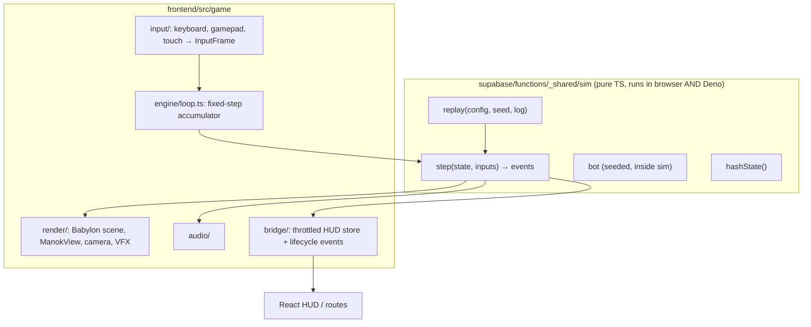

# Game Engine Design (Simulation, Rendering, Input, Bot)

| Field | Value |
|---|---|
| SDLC phase | Design |
| Status | Draft v0.1 |
| Implements | [game-design.md](../01-requirements/game-design.md); FR-FIGHT-*, FR-MATCH-02, NFR-PERF-*, NFR-DET-01 |
| Related | [architecture.md](./architecture.md) ADR-03/ADR-04 |

---

## 1. Layers



**Rule:** the renderer and React may **read** sim state and events. They may **never change** sim state. All gameplay decisions happen in `step()`.

---

## 2. Simulation

### 2.1 Folder layout

```
_shared/sim/
├── index.ts            # public API only (re-exports)
├── version.ts          # export const SIM_VERSION = '1.0.0'
├── types.ts            # SimState, ManokState, InputFrame, SimEvent, MatchConfig
├── math/
│   ├── fixed.ts        # integer helpers (mul, div, clamp, isqrt)
│   └── trig.ts         # 4096-step sin/cos lookup tables (generated, committed)
├── rng.ts              # sfc32 seeded PRNG
├── input.ts            # InputFrame bit layout, log encode/decode (RLE)
├── state.ts            # createInitialState(config, seed)
├── step.ts             # step(state, inputs): SimEvent[]
├── systems/            # movement, actions, combat, hingal, tapang, referee, clash, buffer
├── bot/                # observation buffer, utility scoring, difficulty profiles
├── data/               # constants.ts, actions.ts (frame data), breeds.ts, taris.ts
├── hash.ts             # serialize state → SHA-256 hex (Web Crypto, async)
├── replay.ts           # replay(config, seed, log) → { result, hash }
└── versions/           # frozen copies of older sim versions still needed for replay
```

### 2.2 Determinism rules (NFR-DET-01)

JavaScript numbers are IEEE-754 doubles, and `Math.sin`, `Math.cos`, `Math.atan2`, `Math.pow` and `Math.exp` **are not guaranteed to give identical results** across engines (V8 in Chrome/Deno vs. JavaScriptCore in Safari). Therefore:

1. **Integer (fixed-point) math only** inside the sim.
   - Positions and distances: **integer millimeters** (arena radius = 2000).
   - Velocities: mm per tick.
   - Angles: **binary angle units**, 0–4095 = 0–360°.
   - Trig: `SIN[4096]` / `COS[4096]` lookup tables scaled by 2¹⁴, generated once by a script and committed as integer literals.
   - Square root: integer `isqrt` (Newton's method on integers).
   - Every multiplication/division result is truncated with `Math.trunc` and kept within ±2³¹.
2. **No** `Math.random`, `Date`, `performance.now`, `Map`/`Set` iteration-order dependencies on object keys, or floating-point accumulation.
3. **RNG:** `sfc32`, seeded from the server seed (split into 4×32-bit words with `Math.imul`-based splitmix). Separate RNG streams: `rng.bot[side]`, `rng.ulutan`.
4. **Fixed order:** each tick processes Meron then Wala, in the order of the systems in §2.4.
5. **Pure data:** `SimState` is plain objects/arrays/typed arrays (structured-clone-safe) so it can be snapshotted, which rollback netcode (R3) needs.
6. **CI guard:** an ESLint rule (`no-restricted-properties`/`no-restricted-globals`) forbids the APIs above inside `_shared/sim/**`.

### 2.3 Input frame

One `InputFrame` per side per tick, packed in a **Uint16**:

| Bits | Field | Values |
|---|---|---|
| 0–4 | `dir` | 0 = none, 1–16 = world-space direction in 22.5° steps |
| 5 | `tuka` | pressed this tick |
| 6 | `sipa` | pressed |
| 7 | `lipad` | pressed |
| 8 | `ilag` | pressed |
| 9 | `skill` | pressed |
| 10 | `pause_forfeit` | forfeit request |
| 11–15 | reserved | 0 |

- The client converts camera-relative stick/WASD into **world-space** directions *before* building the frame, so the sim never needs the camera.
- **Input log** (for submission/replay): only the human side(s). It is RLE-encoded as `[value:u16, runLength:u16]` pairs, then base64-encoded. A 90-second match is typically < 4 KB.
- **Input buffer (inside the sim):** an attack pressed during the last **6 ticks** of another action's recovery runs as soon as that action ends. Because the buffer lives in the sim, replays reproduce it exactly.

### 2.4 Tick order (`step`)

1. Decode inputs (bot side: `bot.think(state, side)` produces its frame).
2. Referee / phase machine (`ulutan` → `fight` → `sentensya` → `ended`; hit-pause countdown).
3. Action system: start/advance actions, buffer, costs, cooldowns.
4. Movement: facing, acceleration, Lipad arc, arena clamp, body push.
5. Combat: hit detection for active frames, anti-air, clash detection.
6. Hingal & Tapang regeneration and thresholds (exhausted, talikod).
7. Win checks (KO, talikod, timeout).
8. `tick++`; return `SimEvent[]` (e.g. `action_started`, `hit`, `clash_started`, `clash_resolved`, `exhausted`, `talikod`, `sentensya_started`, `ko`, `match_ended`).

### 2.5 Public API

```ts
export const SIM_VERSION: string;
export function createInitialState(config: MatchConfig, seed: bigint | number): SimState;
export function step(state: SimState, human: { meron?: InputFrame; wala?: InputFrame }): SimEvent[];
export function isEnded(state: SimState): boolean;
export function result(state: SimState): MatchResult;        // winner_side, reason, duration_ticks
export function hashState(state: SimState): Promise<string>;  // SHA-256 hex of canonical serialization
export function encodeInputLog(frames: InputFrame[]): string;
export function decodeInputLog(b64: string): InputFrame[];
export function replay(config: MatchConfig, seed: number, log: string): Promise<{ result: MatchResult; hash: string }>;
```

### 2.6 Versioning

- `SIM_VERSION` follows semver. **Any change that can change a replay's outcome** (numbers, logic, bot) bumps at least the minor version.
- **Golden replay tests:** `sim/__fixtures__/*.json` hold `{config, seed, log, expected_hash}`. CI fails if a hash changes without a version bump.
- When a version bumps, the previous version is copied into `versions/<x.y.z>/` and kept until no `in_progress` match uses it (in practice, one release).

---

## 3. Bot

- **Observation with delay:** the bot keeps a ring buffer of compact observations (positions, action, phase, meters) and reads the one from `reactionTicks` ago (game-design §10). It never reads the human's input.
- **Utility scoring:** each decision tick (every 4 ticks, or right after its own action ends) it scores `approach, retreat, circle_left, circle_right, tuka, sipa, lipad, ilag, skill, wait` from distance, opponent phase (startup/active/recovery), own Hingal, Tapang and arena edge distance. It adds noise `rng.bot.next() * noiseByDifficulty`, and with probability `mistakeRate` picks the 2nd-best option.
- **Clash:** presses Sipa at `reactionTicks ± rng` after the prompt; it can "mash" early with probability `mistakeRate / 2`.
- Difficulty profiles live in `sim/bot/profiles.ts` (they are gameplay data, so they are versioned with the sim).

---

## 4. Client loop

```ts
const TICK_MS = 1000 / 60;
let acc = 0, last = performance.now();
function frame(now: number) {
  acc += Math.min(now - last, 250); last = now;           // clamp after tab stalls
  let steps = 0;
  while (acc >= TICK_MS && steps < 5) {                    // spiral-of-death guard
    const inputs = input.sample(state);                    // human frame for this tick
    log.push(inputs.meron);
    const events = step(state, inputs);
    renderer.onEvents(events); audio.onEvents(events); bridge.onEvents(events);
    acc -= TICK_MS; steps++;
  }
  renderer.render(prevState, state, acc / TICK_MS);       // interpolate visuals
  bridge.maybePublish(state, now);                        // HUD store at 20 Hz
  rafId = requestAnimationFrame(frame);
}
```

- **Bot fights pause automatically** when the tab is hidden (`visibilitychange`) and when the pause menu opens. Pausing stops stepping, so the input log stays valid.
- Render interpolation needs `prevState`: keep a lightweight copy of the render-relevant fields (positions, height, facing, action/phase/progress) from the previous tick.

---

## 5. Rendering (Babylon.js)

### 5.1 Scene
- `Engine` (WebGL2; try `WebGPUEngine` first when available, behind a setting) with `adaptToDeviceRatio` according to the quality tier.
- **Arena:** sand disc, ring wall, banderitas (bunting), crowd silhouettes as billboards (cheap). All static meshes are merged and frozen (`freezeWorldMatrix`, `material.freeze()`).
- **Lighting:** one hemispheric + one directional light (sun) with a 1024 (Medium) / 2048 (High) shadow map. Shadows are **off** on Low; a blob shadow decal under each manok is **always on** (jump readability).
- **Style:** toon look with a 3-band ramp shader (Node Material) + an outline (inverted-hull or edge rendering) on manoks only.

### 5.2 Camera (game-design §15)
`ArcRotateCamera` with no user control in fights. Each frame: target = midpoint of both manoks (lerped); radius = clamp(2.2 m + 0.6 × separation, 2.2, 3.5); beta fixed at ~55°; alpha slowly follows the angle perpendicular to the line between the manoks, so both stay on screen. Shake is applied as a small offset, never by moving the target.

### 5.3 ManokView (sim → visuals)

| Sim | Visual |
|---|---|
| `x, z, facing` | Root transform (interpolated) |
| `height` (Lipad) | Root Y. **Root-bone translation in animation clips is ignored** (clips must be in-place; the sim owns position) |
| `action + phase + progress` | Animation group, **driven by the sim**: `group.goToFrame(start + progress × length)`. Clips are not free-running, so poses always match the frame data |
| `walk speed` | Walk clip, speed ratio by velocity |
| `tapang` | Hackle bones: flare rotation ∝ Tapang (procedural, after animation) |
| `facing to opponent` | Head bone look-at with 40° limit (head stabilization) |
| Comb, wattles, tail | Spring "jiggle" on those bones |
| Hit-pause | Animation frame held; VFX keep playing |

**Clip ↔ action mapping** (prototype asset, Blender @30 fps; the sim timeline is retimed onto the clip):

| Sim action | Clip | Clip key pose aligned to |
|---|---|---|
| `idle` | `Idle` (loop) | — |
| `walk` | `Walk` (loop) | — |
| `tuka` | `Tuka_Peck` | strike pose (clip frame 9) = first active tick |
| `sipa` | `Sipa_Kick` | kick pose (frame 11) = first active tick |
| `lipad_*` | `Lipad_Jump` | crouch (8), apex strike (20) = strike window center, land (33) |
| `hitstun` | `Hit_React` | — |
| `exhausted` | `Hingal_Exhausted` (loop) | — |
| `talikod` | `Talikod_TurnAway` | — |
| `ko` | `KO` | — |
| `ilag` | **missing**: add `Ilag_Dodge` to the asset (task T-ART-02) | — |
| skill `banat` | **missing**: `Banat_Combo` (T-ART-02) | — |

### 5.4 VFX & audio events

| Sim event | VFX | Audio |
|---|---|---|
| `hit` (tuka/sipa/lipad) | Feather burst (size by damage), flash on target | Impact (3 strengths) |
| `clash_started` | Freeze frame, "CLASH!" prompt (React overlay), radial lines | Clash sting |
| `lipad` landing | Dust ring | Thud |
| `exhausted` | Breath puffs | Panting |
| `talikod` / `sentensya_started` | Referee banner "SENTENSYA! 5" (React) | Crowd gasp |
| `ko` | Slow-motion 0.5× for 30 frames (render only), "KO!" | Crowd roar |

Particles use one pooled `ParticleSystem` per effect type (no allocation per hit).

### 5.5 Quality tiers (FR-SET-02)

| Setting | Low | Medium | High |
|---|---|---|---|
| Render scale | 0.75 | 1.0 | device pixel ratio (max 2) |
| Real shadows | off | 1024 | 2048 PCF |
| Outline | off | on | on |
| Crowd billboards | 0 | 40 | 120 |
| Particles max | 150 | 400 | 800 |
| FPS cap | 30 | 60 | 60/120 |

Auto-detect on first run: start at Medium; if the average FPS stays < 50 for 5 seconds in the lobby preview, suggest Low.

---

## 6. Input

| Action | Keyboard (default) | Gamepad (standard mapping) | Touch (R2) |
|---|---|---|---|
| Move | WASD / arrow keys | Left stick / D-pad | Left virtual stick |
| Tuka | J | A / Cross | Button |
| Sipa | K | X / Square | Button |
| Lipad | Space | B / Circle | Button |
| Ilag | Shift / L-Shift | RB / R1 | Swipe |
| Skill | L | Y / Triangle | Button |
| Pause | Esc / P | Start | Pause icon |

- Bindings are stored in `settingsStore` (persisted). Rebinding UI is FR-SET-04.
- A press is **edge-triggered** (down this tick, not held) so a held key does not repeat attacks.
- Inputs are sampled once per sim tick. Key events between ticks are accumulated, so a tap shorter than one tick is never lost.

---

## 7. Assets

| Asset | Source | Budget |
|---|---|---|
| Manok model + rig + clips | `tools/blender/build_manok.py` (headless Blender via `bpy`), exported `.glb` | ≤ 1 MB per breed after compression; 39 bones; ≤ 4 weights/vertex |
| Arena | Babylon primitives + 1–2 small textures | ≤ 1 MB |
| Audio | `.ogg` + `.m4a` fallback | ≤ 1.5 MB total for R1 |

Pipeline: `npm run assets:build` runs Blender (`python tools/blender/build_manok.py --out …`), then `gltf-transform` (`dedup`, `prune`, `meshopt`, `resample`). Outputs go to `frontend/public/models/`. Babylon loads meshopt-compressed glTF with `MeshoptCompression` configured.

Breeds share **one skeleton and one clip set**. Breed differences are mesh/material swaps plus bone scale (see the rigging notes in the project history). New clips must keep bone names unchanged.

---

## 8. React bridge

- `src/game/bridge/hudStore.ts`: a **vanilla Zustand store** (`createStore`), published at **20 Hz** (not every tick) with `{hp, hingal, tapang, timer, phase, cooldowns}` for each side. HUD components subscribe with selectors, so React re-renders stay cheap.
- **Lifecycle events** go through an event emitter, not the store: `match_ended` → the `match` feature submits the result and navigates to the results route; `clash_started` → overlay prompt.
- `FightView` (organism) mounts the Babylon engine in `useEffect`, disposes **everything** on unmount (engine, scene, observers, listeners), and is wrapped in an error boundary that shows `WebGLNotSupported` / "Something went wrong" with a "Back to lobby" button.

---

## 9. Offline & resilience

- PWA caches the app shell, models and audio, so bot fights work offline.
- Submissions are queued in IndexedDB (`pending_submissions`) and retried with exponential backoff (1 s, 2 s, 4 s … max 60 s; and on `online` event). Matches older than 30 minutes cannot be verified (api-design §6.1), so the queue informs the player if a submission expired.
- Starting a match needs the server (seed). Offline → "Practice mode" (local seed, no rewards, not saved). This is a Could-have for R1.
